<p align="center"></p>

# Sell It Habibi!

Peer-to-peer marketplace for the Middle East (Android, iOS, Web). Expo SDK 57, Expo Router, TypeScript, NativeWind v4.

## Screenshots

Captured from the web build in demo mode (no backend needed), English and Arabic (RTL), light and dark. The same code runs on Android, iOS and web.

| Home | Listing | Search + filters | Sell with AI autofill |
| :--: | :--: | :--: | :--: |
| 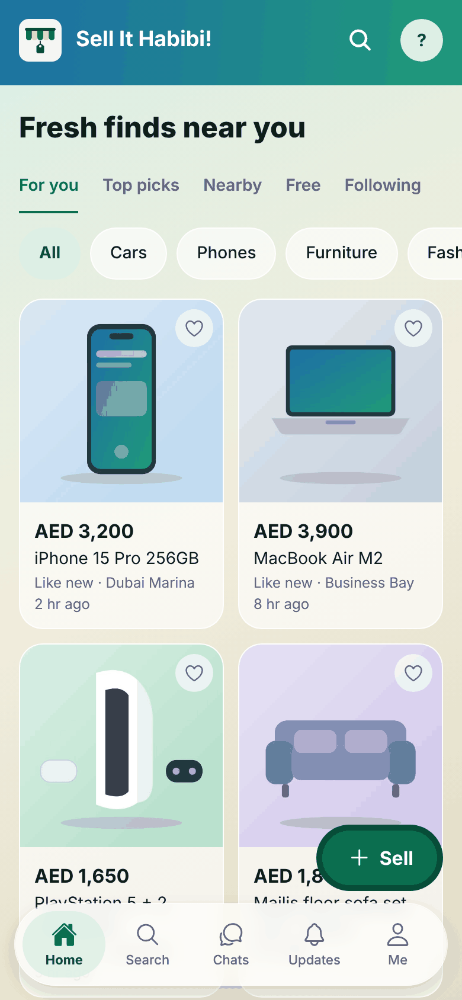 | 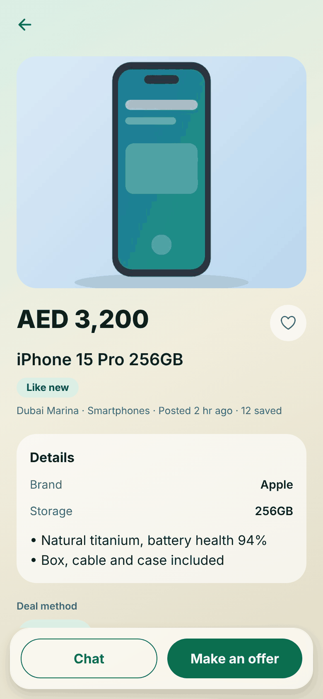 | 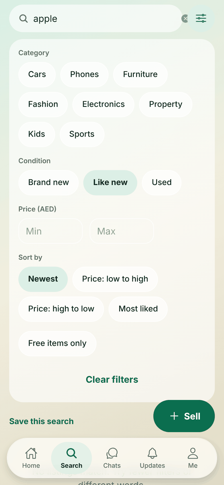 | 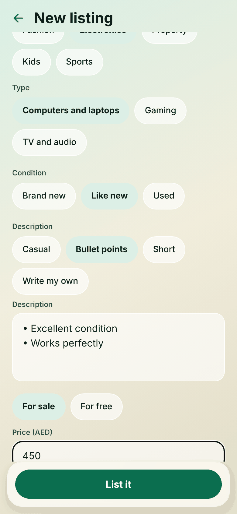 |

| Chat + offers | Seller reviews | Chats | Moderation queue |
| :--: | :--: | :--: | :--: |
| 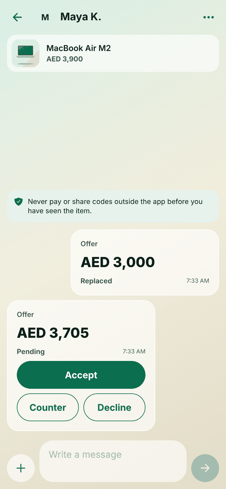 | 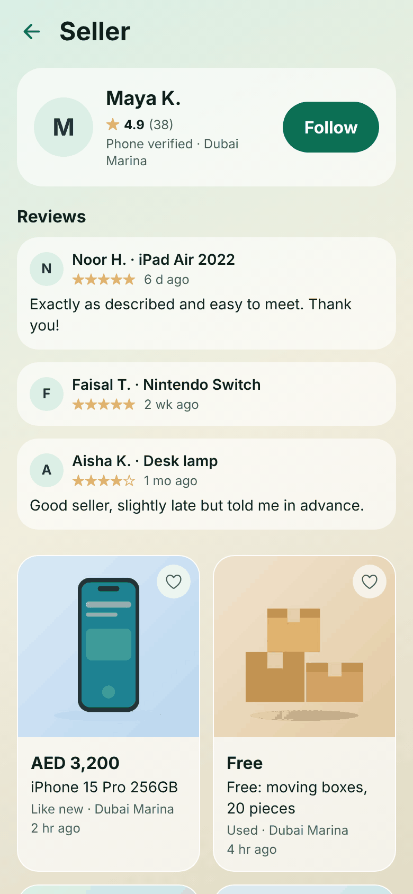 | 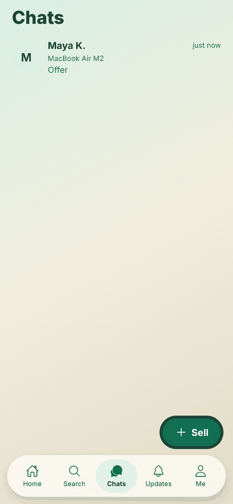 | 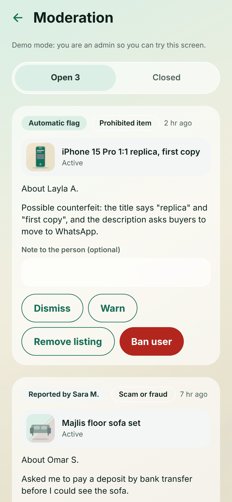 |

| Dark mode | Arabic (RTL) | Classic flat look |
| :--: | :--: | :--: |
| 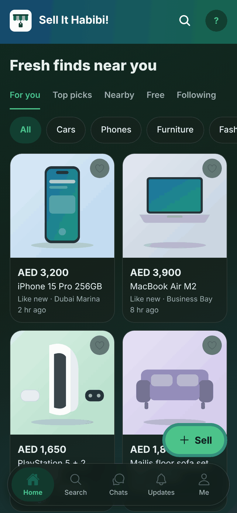 | 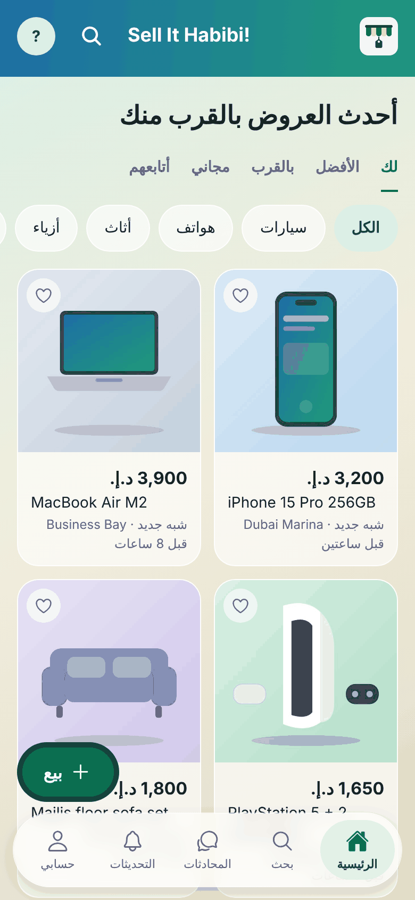 | 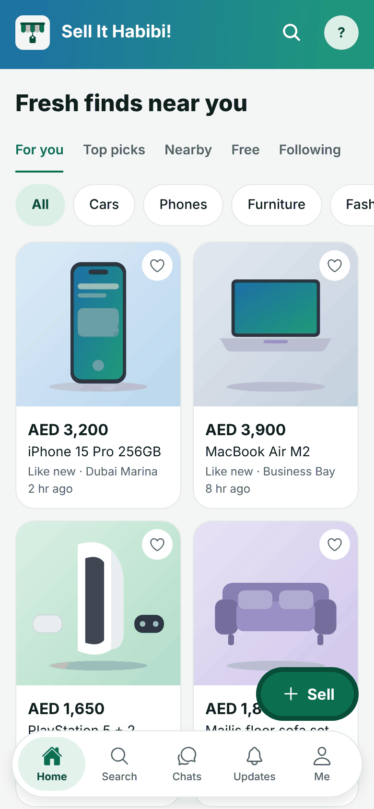 |

Two looks, switchable in Settings: **Frosted glass** (default; translucent cards and a blurred floating bar over a soft gradient) and **Classic flat** (solid surfaces).

Wide web layout (sidebar):

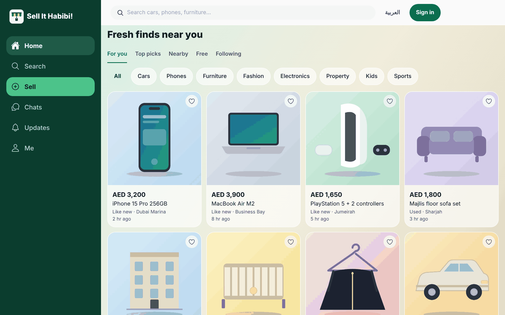

To regenerate: build the web export (`npx expo export -p web`), serve `dist/`, and run the Playwright script described in `design/README.md`.

## Run

```bash
npm install
npx expo start          # press a (Android), i (iOS), w (web)
```

## Structure

```
app/              Screens (file-based routing)
  _layout.tsx       Root stack, providers, route guards
  (tabs)/           Home, Search, Sell, Chats, Profile
  sign-in, verify   Phone OTP + Google/Apple (signed-out only)
  onboarding        First-run profile setup (new accounts only)
  edit-profile, settings
  listing/new, listing/[id]/ (detail, edit), my-listings, favorites, seller/[id]
  thread/[id]       One conversation: messages, offers, meet-ups, photos, mute/block/report
components/
  layout/           BottomBar (mobile), Sidebar + WebHeader (wide web)
  ui/               Button, TextField, Chip, Avatar, Screen, GradientHeader…
  listings/         ListingCard, ListingGrid, ListingForm, EmptyState
  chat/             MessageBubble, offer / meet-up / safety sheets
constants/          Navigation, colors/theme tokens, countries + currencies
hooks/              useIsWideScreen, useGridColumns
i18n/               en.ts (source of keys) and ar.ts (typed to match)
lib/                money (integer minor units), phone, Arabic search folding, listing query/ranking, offer rules, meet-up slots, push registration,
                    AI-suggestion sanitiser, supabase client
providers/          PrefsProvider (language, RTL, country), AuthProvider, EngagementProvider (likes, follows), InboxProvider (tab badges)
services/           auth, profile, listings, engagement, ai, chat, updates (Supabase, or local demo data when unconfigured)
scripts/            check-logic.ts (npm test)
supabase/migrations SQL schema with row-level security
supabase/functions  suggest-listing (photo to listing details with Claude), send-push (Expo pushes)
supabase/tests      database checks you can run against a scratch Postgres
design/mockups.html UI mockups (mobile + web)
```

## Try it on an Android phone

Push to the `release` branch (or run the **Android APK (test build)** workflow by hand). A few minutes later a pre-release appears under the repo's **Releases** with two files: `…-arm64-v8a.apk` for most phones and `…-armeabi-v7a.apk` for older 32-bit phones. Download one on the phone, open it, and allow "install unknown apps" if Android asks. The app starts in demo mode. If the app closes unexpectedly, the next launch shows what went wrong with a Share button.

## What needs an account

Browsing needs none: feed, search, listings, sellers, likes, follows, saved searches and reporting all work as a guest (likes, follows and saved searches are kept on the phone and moved into the account at sign-in). An account is needed only to chat (including offers and meet-ups) and to sell. Payment and handover happen outside the app, so there is no checkout.

## Backend (Supabase)

Without environment variables the app runs in **demo mode**: sample listings, and sign-in accepts the code `123456`. Data stays on the device.

To connect a real backend:

1. Create a Supabase project and run `supabase/migrations/0001_init.sql` in the SQL editor (or `supabase db push`).
2. Authentication > Providers: enable **Phone** (choose an SMS provider such as Twilio; check it covers UAE/KSA numbers), and optionally **Google** and **Apple**. Add `sellithabibi://auth/callback` and your web origin to the redirect URLs.
3. Copy `.env.example` to `.env` and fill in `EXPO_PUBLIC_SUPABASE_URL` and `EXPO_PUBLIC_SUPABASE_ANON_KEY`. For EAS builds set the same two as EAS environment variables.

The anon key is safe to ship; access is enforced by row-level security in the migrations. Run `0001` to `0005` in order.

### AI listing autofill

The Sell form reads the first photo with Claude and fills in title, category, condition, description and a price range. It runs in a Supabase Edge Function so the API key never reaches the app:

```bash
supabase functions deploy suggest-listing
supabase secrets set ANTHROPIC_API_KEY=sk-ant-...
# optional: supabase secrets set ANTHROPIC_MODEL=claude-sonnet-5-5   (default is claude-opus-5-5)
```

Only signed-in users can call it. Each call sends one photo to the Anthropic API, so watch usage and add a per-user limit before launch. If the function is missing or fails, the form says so and stays manual. Without Supabase the app returns a fixed demo suggestion.

### Moderation and staff

People who work as moderators open **Profile > Moderation**. A staff role can't be given from the app. In the Supabase SQL editor run:

```sql
update public.profiles set role = 'admin' where id = '<the person's user id>';   -- or 'moderator'
```

Reports from people and automatic flags land in one queue. Actions are: dismiss, warn, remove the listing, ban the user (a ban also removes their listings; staff can lift it). The people affected get a notification. In demo mode everyone is an admin so you can try the screen.

**Automatic checks.** `moderate-listing` flags new and edited listings that match the prohibited-items list or that Claude thinks a moderator should see. It never removes anything by itself.

```bash
supabase functions deploy moderate-listing --no-verify-jwt
supabase secrets set MODERATION_WEBHOOK_SECRET=<random string>      # ANTHROPIC_API_KEY is shared with suggest-listing
# Dashboard > Database > Webhooks: table listings, events INSERT and UPDATE, function moderate-listing, header x-webhook-secret
```

The prohibited-items list is `supabase/functions/_shared/prohibited.json`, used by both the app and the function. It is a **starter list that needs legal review for each country** before launch.

### Chat and push notifications

Chat works as soon as migration `0003` is applied (realtime is switched on for the chat tables when your project has the `supabase_realtime` publication). In demo mode the seller is a bot: it answers messages, accepts offers of 90% or more, counters 70 to 90%, and declines lower ones.

Pushes need three more things:

1. `npx eas-cli@latest init` (adds the EAS project id the app needs to get a push token) and a development or production build. Pushes don't work in Expo Go or on simulators.
2. Credentials: an FCM key for Android and an APNs key for iOS (`eas credentials`).
3. Deploy the function and add a Database Webhook so it runs when a notification is created:

```bash
supabase functions deploy send-push --no-verify-jwt
supabase secrets set PUSH_WEBHOOK_SECRET=<random string>
# Dashboard > Database > Webhooks: table notifications, event INSERT, function send-push, header x-webhook-secret
```

Push text is short and shows English and Arabic together, because the app doesn't store each person's language on the server yet.

## Tests

```bash
npm run typecheck && npm run lint && npm test
```

`npm test` covers money, phone and name rules, Arabic search folding, listing filters, sorting and ranking, and the AI-output sanitiser. `supabase/tests/` has database checks.

## Language and layout direction

English and Arabic. The language defaults to the device language and can be changed in Settings. On web the page direction flips immediately. On Android and iOS the layout direction changes the next time the app is opened. Add UI text to `i18n/en.ts` first, then `i18n/ar.ts` (the type checker flags a missing key).

Money is always stored as integer minor units (`lib/money.ts`); never use floats for prices.

## Responsive navigation

`components/layout/responsive-tab-bar.tsx` renders the bottom bar on native and on web below 768px,
and the left sidebar plus top search header on web at 768px and wider. Change the breakpoint in `constants/navigation.ts`.
To add a tab: add an entry to `NAV_ITEMS` and a matching file in `app/(tabs)/`.

## Styling

Use Tailwind classes via `className`. Brand colors live in `constants/colors.js` (`brand-600`, etc.) and feed `tailwind.config.js`.
Dark mode follows the system setting (`dark:` variants).
